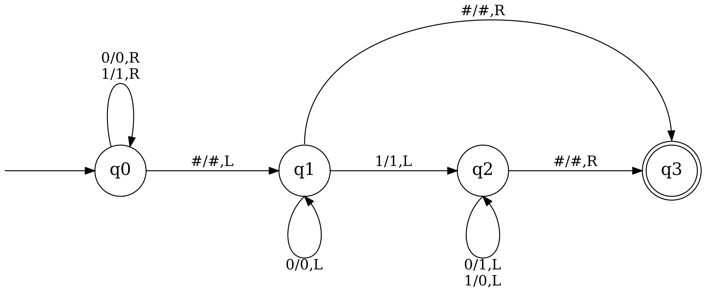
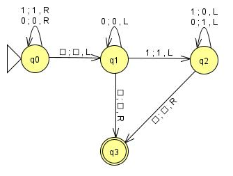
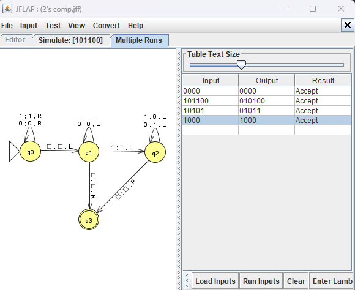

# Turing Machine for Binary 2's Complement

A four-state deterministic Turing Machine that converts a binary string into its **2's complement in place**, designed and simulated in JFLAP.

Project for **Formal Languages and Automata Theory (FLAT)**, Amal Jyothi College of Engineering (Autonomous), Kanjirappally, Department of Computer Science and Engineering.



## Problem

A digital arithmetic unit needs the 2's complement of an arbitrary binary string for signed integer operations. Given `w ∈ {0, 1}*` on the tape, the machine must overwrite it with the n-bit value `(2ⁿ − w) mod 2ⁿ`, using no extra tape or memory.

## Idea

Instead of "invert all bits and add 1", the machine uses an equivalent rule that needs only reads, writes and moves:

> Scan from the right. Keep every bit up to and including the **first 1**. **Invert** every bit after it.

| Input | Output | Why |
|-------|--------|-----|
| `101100` | `010100` | `100` kept, `101` inverted |
| `0110` | `1010` | 6 → −6 in four bits |
| `1111` | `0001` | −1 → 1 |
| `0000` | `0000` | no 1, so unchanged (−0 = 0) |

## Formal definition

`M = (Q, Σ, Γ, δ, q0, #, F)`

- Q = {q0, q1, q2, q3}
- Σ = {0, 1}
- Γ = {0, 1, #}
- q0 is the start state, `#` is the blank, F = {q3}

| State | Role |
|-------|------|
| q0 | Scan right to the blank after the string |
| q1 | Move left over trailing zeros until the first 1 |
| q2 | Keep that 1, then invert every bit moving left |
| q3 | Final state, machine halts |

### Transition table

| State | Read | Next | Write | Move |
|-------|------|------|-------|------|
| q0 | 0 | q0 | 0 | R |
| q0 | 1 | q0 | 1 | R |
| q0 | # | q1 | # | L |
| q1 | 0 | q1 | 0 | L |
| q1 | 1 | q2 | 1 | L |
| q1 | # | q3 | # | R |
| q2 | 0 | q2 | 1 | L |
| q2 | 1 | q2 | 0 | L |
| q2 | # | q3 | # | R |

## Example run: `101100`

```
#[q0]101100#   start
#101100[q0]#   q0 reaches the blank
#10110[q1]0#   turn back, skip trailing zeros
#10[q2]1100#   first 1 kept, enter q2
[q2]#010100#   remaining bits inverted
#[q3]010100#   halt, output 010100 (14 steps)
```

The state is written in brackets and the head is on the symbol just to its right.

## Results

- **JFLAP:** built and stepped through on `101100`; Multiple Run on `0000`, `101100`, `10101`, `1000` gave `0000`, `010100`, `01011`, `1000`.
- **Simulator:** matches the arithmetic definition for all **8191** binary strings of length 0 to 12.
- **Running time:** exactly **2n + 2** transitions for a string of length n, so O(n).

| JFLAP editor | Multiple Run |
|---|---|
|  |  |

Step-by-step screenshots are in [`images/`](images).

## Run it

Requires Python 3, no packages.

```bash
python tm_simulator.py 101100     # trace for one input
python tm_simulator.py --verify   # exhaustive check, length 0 to 12
```

To reproduce the JFLAP model, create a Turing Machine in JFLAP with the transitions above (JFLAP draws the blank as □), mark q0 as initial and q3 as final.

## Repository layout

```
.
├── README.md
├── tm_simulator.py        # simulator and exhaustive verifier
├── report/
│   └── TM_Project_Report.docx   # full project report
└── images/                # state diagram, JFLAP screenshots, charts
```

## Limitations

The machine works on a fixed width, so the 2's complement of the most negative value (a 1 followed by zeros) is the number itself, and it assumes the input contains only 0 and 1.

## Team (Group 5)

- Anusree Babu (S5CY#07)
- Anitta Vincent (S5CY#05)
- Jayanth Mathew (S5CY#14)
- Rosh K Lijo (S5CY#26)

## References

1. J. E. Hopcroft, R. Motwani and J. D. Ullman, *Introduction to Automata Theory, Languages, and Computation*, 3rd ed., Pearson, 2006.
2. M. Sipser, *Introduction to the Theory of Computation*, 3rd ed., Cengage, 2012.
3. M. M. Mano and M. D. Ciletti, *Digital Design*, 5th ed., Pearson, 2013.
4. JFLAP, <https://www.jflap.org/>
